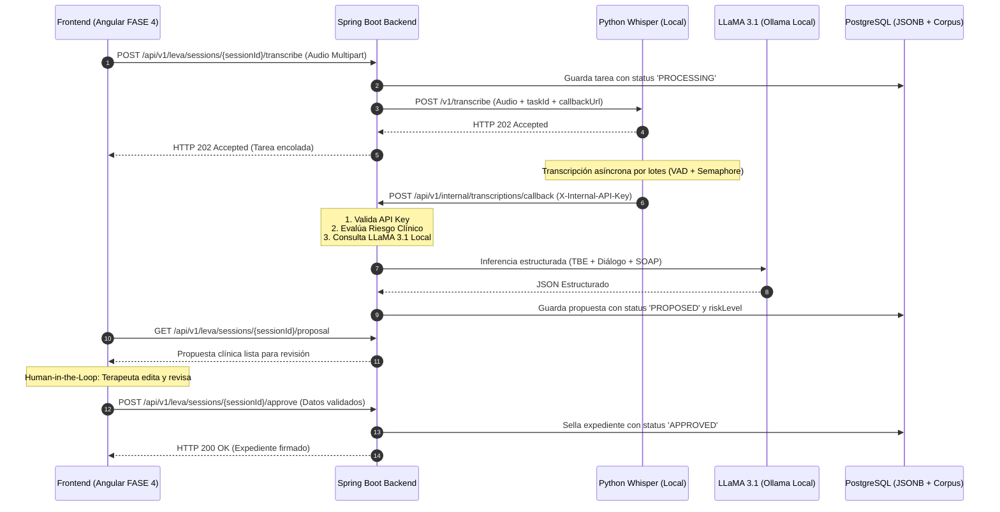

# 📄 SDD-003: Especificación del Motor de Inteligencia Clínica "LEVA"

> **Módulo:** LEVA Clinical Copilot (Motor de IA Especializado en Terapia Breve Estratégica)  
> **Versión:** 1.0.0  
> **Fecha:** Octubre 2026  
> **Estado:** APROBADO / LISTO PARA CONSUMO FRONTEND (FASE 4)  
> **Audiencia:** Equipo de Frontend (Angular 18+), Backend (Spring Boot), Clínico y QA

---

## 1. 🎯 Visión y Principios No Negociables de LEVA

**LEVA** no es un chatbot conversacional genérico. Es un **Copiloto Clínico Especializado** diseñado para asistir al psicólogo o terapeuta en el modelo de **Terapia Breve Estratégica (TBE - Nardone/Watzlawick)**, **CIE-11** y **DSM-5TR**, bajo los siguientes pilares estrictos:

1. **Confidencialidad Radical (100% On-Premise):**  
   Cero telemetría externa. La voz se transcribe con `faster-whisper` en local y la inferencia semántica corre mediante **LLaMA 3.1 8B Instruct** en Ollama (`127.0.0.1:11434`). Ningún dato de paciente ni manual clínico sale a la nube pública.
2. **Autollenado Estructurado de Expediente:**  
   LEVA sintetiza y propone el llenado automático de campos clínicos de TBE (Diagnóstico Operativo, Sistema Perceptivo-Reactivo, Tentativas de Solución, Reestructuraciones, Prescripciones, Valoración del Cambio y Nota SOAP).
3. **Human-in-the-Loop Obligatorio:**  
   LEVA **nunca** prescribe ni diagnostica en firme. Genera una propuesta en estado `PROPOSED` que el profesional humano **debe revisar, editar y firmar** (`APPROVED`) en la interfaz de Angular.
4. **Detección y Escalamiento Inmediato de Riesgo:**  
   Identifica indicadores de suicidio, autolesión y violencia, activando banderas de severidad (`HIGH`/`CRITICAL`) y protocolos de derivación médica prioritaria.
5. **Corpus Clínico Cerrado (RAG):**  
   Responde consultas formativas y clínicas apoyándose **únicamente** en los manuales propietarios del proyecto (15+ protocolos TBE, guías DSM-5TR y CIE-11).

---

## 2. 🏛️ Arquitectura del Flujo Clínico



---

## 3. 🚦 Máquina de Estados Human-in-the-Loop (HITL)

| Estado | Descripción | Acción del Terapeuta en Frontend |
| :--- | :--- | :--- |
| `PROPOSED` | LEVA generó la propuesta automática tras procesar el audio. | Ver texto resaltado y sugerencias de LEVA. |
| `UNDER_REVIEW` | El terapeuta tiene el formulario abierto y está editando. | Modificar libremente campos y turnos de diálogo. |
| `APPROVED` | El terapeuta hizo clic en **"Aprobar y Sellar Expediente"**. | Expediente oficial cerrado con fecha y firma. |
| `REJECTED` | El terapeuta descartó la propuesta por audio defectuoso. | Reingreso manual de la nota. |

---

## 4. 🔌 Catálogo de Endpoints REST (Contrato Oficial para FASE 4)

Todos los endpoints (salvo el webhook interno) requieren token JWT de sesión:  
`Authorization: Bearer <jwt_token>`

---

### A. `POST /api/v1/leva/sessions/{sessionId}/transcribe`
Sube la grabación de la sesión e inicia el análisis clínico de LEVA.

* **Parámetros URL:**  
  `sessionId` (UUID o string identificador de la cita).
* **Content-Type:** `multipart/form-data`
* **Form-Data:**
  - `file`: Archivo binario de audio (`.mp3`, `.wav`, `.m4a`, `.ogg`, `.mp4`).
  - `language`: `es` (opcional, por defecto `es`).

**Respuesta Exitosa (HTTP 202 Accepted):**
```json
{
  "id": "e4d8a1c9-772b-45fc-9a6d-23910b8cf812",
  "sessionId": "cita-12345",
  "pacienteId": "pac-987",
  "terapeutaId": "ter-555",
  "status": "PROCESSING",
  "audioFileName": "sesion_01.mp4",
  "durationSeconds": 0.0,
  "languageDetected": null,
  "rawResult": null,
  "errorMessage": null,
  "createdAt": "2026-10-11T19:38:58Z",
  "updatedAt": "2026-10-11T19:38:58Z"
}
```

---

### B. `GET /api/v1/leva/sessions/{sessionId}/proposal`
Obtiene la propuesta generada por LEVA para la sesión (autollenado de campos).

**Respuesta Exitosa (HTTP 200 OK):**
```json
{
  "proposalId": "prop-a1b2c3d4",
  "taskId": "e4d8a1c9-772b-45fc-9a6d-23910b8cf812",
  "sessionId": "cita-12345",
  "pacienteId": "pac-987",
  "terapeutaId": "ter-555",
  "humanReviewStatus": "PROPOSED",
  "riskLevel": "NONE",
  "riskAlertDetails": {
    "level": "NONE",
    "detectedTriggers": [],
    "riskCategories": [],
    "recommendedProtocol": "Sin indicadores de riesgo inminente detectados.",
    "escalationSummary": "Evaluación automática completada. Nivel: NONE",
    "requiresImmediateHumanIntervention": false
  },
  "structuredProposal": {
    "diagnosticoOperativo": "Trastorno de pánico con agorafobia reactiva.",
    "sistemaPerceptivoReactivo": "Fóbico-obsesivo",
    "tentativasSolucionRedundantes": [
      "Evitación sistemática de salir sola",
      "Petición constante de reaseguración a familiares"
    ],
    "reestructuracionesPropuestas": [
      "El miedo mirado de frente se convierte en valor; el miedo evitado se convierte en pánico."
    ],
    "prescripcionesEstrategicas": [
      "La peor fantasía (media hora diaria programada)",
      "Diario de a bordo de episodios ansiosos"
    ],
    "valoracionDelCambio": "Sesión diagnóstica inicial. Establecimiento de alianza terapéutica.",
    "estratagemaAplicada": "Declaración del síntoma / Paradoja estratégica",
    "reaccionPaciente": "Comprensión del mecanismo de evitación y aceptación de la tarea.",
    "notaEvolucionSoap": "S: Paciente femenina de 43 años acude manifestando crisis de angustia recurrentes...\nO: Discurso coherente, hipervigilancia somática evidente...\nA: Se identifican tentativas de solución redundantes que alimentan el círculo vicioso...\nP: Se prescribe La Peor Fantasía y registro en Diario de a Bordo.",
    "dialogue": [
      {
        "speaker": "Terapeuta",
        "text": "Hola, yo soy tu terapeuta. Dime cómo te llamas.",
        "timestampStart": 0.0,
        "timestampEnd": 3.8
      },
      {
        "speaker": "Paciente",
        "text": "Me llamo Daniela Orozco.",
        "timestampStart": 4.1,
        "timestampEnd": 5.9
      }
    ]
  },
  "approvedData": null,
  "reviewedById": null,
  "reviewedAt": null,
  "createdAt": "2026-10-11T19:40:12Z"
}
```

---

### C. `POST /api/v1/leva/sessions/{sessionId}/approve`
**Human-in-the-Loop:** El terapeuta valida, edita y firma formalmente el expediente clínico.

* **Payload de Entrada (JSON):**
```json
{
  "reviewedById": "ter-555",
  "approvedData": {
    "diagnosticoOperativo": "Trastorno de pánico con agorafobia reactiva (Confirmado por terapeuta).",
    "sistemaPerceptivoReactivo": "Fóbico-obsesivo",
    "tentativasSolucionRedundantes": [
      "Evitación de salir sola a lugares abiertos"
    ],
    "reestructuracionesPropuestas": [
      "El miedo evitado se convierte en pánico."
    ],
    "prescripcionesEstrategicas": [
      "La peor fantasía 30 minutos al día"
    ],
    "valoracionDelCambio": "Definición del problema acordada con la paciente.",
    "estratagemaAplicada": "La peor fantasía",
    "reaccionPaciente": "Receptiva y comprometida con el registro diario.",
    "notaEvolucionSoap": "Nota validada y complementada con observaciones del terapeuta.",
    "dialogue": []
  }
}
```

**Respuesta Exitosa (HTTP 200 OK):**
Retorna la propuesta con:
- `"humanReviewStatus": "APPROVED"`
- `"reviewedById": "ter-555"`
- `"reviewedAt": "2026-10-11T19:45:00Z"`

---

### D. `GET /api/v1/leva/sessions/{sessionId}/risk-status`
Consulta rápida del semáforo de riesgo para alertas en la interfaz.

**Respuesta en caso de Alerta de Riesgo (HTTP 200 OK):**
```json
{
  "sessionId": "cita-12345",
  "riskLevel": "CRITICAL",
  "requiresImmediateIntervention": true,
  "detectedTriggers": [
    "no quiero vivir",
    "pastillas"
  ],
  "riskCategories": [
    "IDEACION_SUICIDA_O_AUTOLESION"
  ],
  "recommendedProtocol": "ALERTA ROJA CLÍNICA: Activar Protocolo de Derivación Urgente a Psiquiatría y Notificación a Persona de Apoyo (NOM-004-SSA3).",
  "escalationSummary": "Evaluación automática completada. Nivel: CRITICAL"
}
```

> **Comportamiento en Angular FASE 4:** Si `requiresImmediateIntervention === true`, Angular debe desplegar un **Modal Rojo Bloqueante** con los números de contacto de emergencia de la persona de apoyo y el protocolo de derivación.

---

### E. `POST /api/v1/leva/corpus/query`
Consulta RAG sobre el corpus clínico cerrado (Protocolos TBE, DSM-5TR, CIE-11).

* **Payload de Entrada (JSON):**
```json
{
  "query": "¿Cuál es la prescripción principal para un ataque de pánico según TBE?",
  "protocolFilter": "TBE-PANICO-01"
}
```

**Respuesta Exitosa (HTTP 200 OK):**
```json
{
  "query": "¿Cuál es la prescripción principal para un ataque de pánico según TBE?",
  "answer": "Con base en el Protocolo TBE: Ataque de Pánico y Agorafobia (TBE-PANICO-01), la prescripción principal es 'La Peor Fantasía', donde el paciente debe dedicar exactamente media hora diaria en un lugar seguro a imaginar voluntariamente sus peores temores...",
  "citedSources": [
    {
      "protocolCode": "TBE-PANICO-01",
      "title": "Protocolo TBE: Ataque de Pánico y Agorafobia",
      "category": "PROTOCOLO_TBE",
      "reference": "G. Nardone - Miedo, Pánico, Fobias (2000)"
    }
  ],
  "groundedInCorpus": true
}
```

---

### F. `GET /api/v1/leva/corpus/protocols`
Retorna la lista de protocolos disponibles cargados en el corpus clínico cerrado.

**Respuesta (HTTP 200 OK):**
```json
[
  {
    "id": "corp-tbe-001",
    "title": "Protocolo TBE: Ataque de Pánico y Agorafobia",
    "protocolCode": "TBE-PANICO-01",
    "category": "PROTOCOLO_TBE",
    "sourceReference": "G. Nardone - Miedo, Pánico, Fobias (2000)"
  },
  {
    "id": "corp-tbe-002",
    "title": "Protocolo TBE: Trastorno Obsesivo-Compulsivo (TOC)",
    "protocolCode": "TBE-TOC-02",
    "category": "PROTOCOLO_TBE",
    "sourceReference": "G. Nardone & Portelli (2013)"
  }
]
```

---

## 5. 📦 Modelos TypeScript para Frontend Angular (FASE 4)

El equipo de Frontend puede copiar directamente estas interfaces en `src/app/core/models/leva.models.ts`:

```typescript
export type HumanReviewStatus = 'PROPOSED' | 'UNDER_REVIEW' | 'APPROVED' | 'REJECTED';
export type RiskLevel = 'NONE' | 'LOW' | 'MEDIUM' | 'HIGH' | 'CRITICAL';

export interface DialogueTurn {
  speaker: string; // 'Terapeuta' | 'Paciente'
  text: string;
  timestampStart?: number;
  timestampEnd?: number;
}

export interface StructuredProposalData {
  diagnosticoOperativo: string;
  sistemaPerceptivoReactivo: string;
  tentativasSolucionRedundantes: string[];
  reestructuracionesPropuestas: string[];
  prescripcionesEstrategicas: string[];
  valoracionDelCambio: string;
  estratagemaAplicada: string;
  reaccionPaciente: string;
  notaEvolucionSoap: string;
  dialogue: DialogueTurn[];
}

export interface RiskAssessment {
  level: RiskLevel;
  detectedTriggers: string[];
  riskCategories: string[];
  recommendedProtocol: string;
  escalationSummary: string;
  requiresImmediateHumanIntervention: boolean;
}

export interface LevaProposalResponse {
  proposalId: string;
  taskId: string;
  sessionId: string;
  pacienteId: string;
  terapeutaId: string;
  humanReviewStatus: HumanReviewStatus;
  riskLevel: RiskLevel;
  riskAlertDetails: RiskAssessment;
  structuredProposal: StructuredProposalData;
  approvedData?: StructuredProposalData;
  reviewedById?: string;
  reviewedAt?: string;
  createdAt: string;
}

export interface RiskAlertResponse {
  sessionId: string;
  riskLevel: RiskLevel;
  requiresImmediateIntervention: boolean;
  detectedTriggers: string[];
  riskCategories: string[];
  recommendedProtocol: string;
  escalationSummary: string;
}

export interface CorpusCitedSource {
  protocolCode: string;
  title: string;
  category: string;
  reference: string;
}

export interface CorpusQueryResponse {
  query: string;
  answer: string;
  citedSources: CorpusCitedSource[];
  groundedInCorpus: boolean;
}
```
