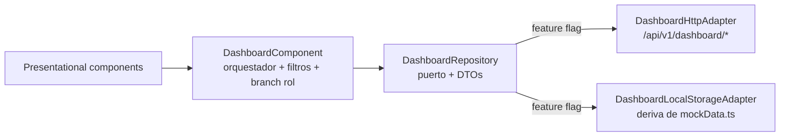

# SDD-003: Software Design Document — Módulo Dashboard (Centro de Control)

- **Módulo**: `dashboard`
- **Código SDD**: `SDD-003`
- **Versión**: 1.1.0 *(reconciliado tras validación de las 3 capas, pendiente de implementación)*
- **Fecha**: 2026-10-12
- **Estado**: DISEÑADO Y RECONCILIADO — contrato TS↔DTO unificado (validado por backend/frontend/BD)
- **Alineación Normativa**: ADR-001 (Hexagonal/SDOP), ADR-002 (Dual Adapters), ADR-003 (Flyway), `gap-report-dashboard.md` (GAP-DASH-01..10)
- **Fuente de verdad de negocio**: `brevemente_demo/src/pages/Dashboard.tsx`

> **Regla de Oro**: integrar vía adaptador/puerto, conservando HTML/SCSS del frontend **100% intactos**. El dashboard se construye sobre el **backend real** (reutilización hexagonal), no sobre mocks; los mocks del adapter localStorage solo sirven de puente en dev.
>
> **Nota de alcance (reconciliación 2026-10-12)**: la Regla de Oro aplica a los módulos que se integran vía puerto sin tocar su presentación. El módulo `dashboard` es **nuevo**, por lo que su `dashboard.component.html` sí se modifica (quitar "Horas Supervisión", añadir acción dominante, anillo/semáforo, drilldowns). El HTML/SCSS de los **demás** módulos permanece intacto.

> **Decisiones del equipo (2026-10-12)**:
> 1. **NO** se implementa el selector de doctor (demo-only).
> 2. **NO** se implementa el botón "Demo Guiada".
> 3. El botón **LEVA ya existe** → no se cuenta como faltante.
> 4. **SE QUITA** la card "Horas Supervisión" (sin fuente de datos; el `34` es inventado).
> 5. **SE MANTIENEN** los botones de cabecera "Nuevo Paciente" y "Agendar Cita".

---

## 0. Propósito y alcance

Portar a producción (backend Spring Boot + PostgreSQL + Angular) el **Centro de Control** de la demo React, con paridad funcional: KPIs con semántica correcta, filtros, perspectiva clínica unificada, acción operativa dominante, anillo de progreso + semáforo, drilldowns y vistas por rol. Hoy el dashboard Angular está **hardcodeado** (`dashboardBackend: false` → adapter localStorage + `mockData.ts`, `horasSupervisadas: 34` literal) y su adapter HTTP apunta a `/api/v1/dashboard/*`, que **no existe** en el backend.

### Alcance por fases

| Fase | Contenido | Bloqueado por |
| :--- | :--- | :--- |
| **Inmediata** | Backend `dashboard` real + alinear métricas + activar `dashboardBackend: true` + quitar "Horas Supervisión" + Acción Operativa Dominante + anillo/semáforo | — |
| **Posterior** | Filtros `sede`/`protocolo`, gráficas "fase TBE" y "casos por protocolo", alerta de mayoría de edad, vistas por rol paciente/alumno | Bloques B y C |

---

## 1. Plan de convergencia (3 capas)

### 1.1 Capa de datos — `jarvis-database`

**Esquema real ya disponible (V1–V8):**

| Métrica | Fuente | Soporte |
| :--- | :--- | :--- |
| Pacientes activos | `pacientes.status = 'activo'` | ✅ `idx_pacientes_status` |
| Citas de hoy | `citas.fecha_hora_inicio` (día actual) | ✅ `idx_citas_fecha` |
| Alertas de consentimiento | `estado_consentimiento` / `consentimiento_representante_firmado = FALSE` | ✅ `idx_pacientes_estado_consentimiento` |
| Pendientes clínicos | `pacientes.status = 'pendiente'` | ✅ `idx_pacientes_status` |
| Alertas de riesgo | `pacientes.risk_level IN ('medio','alto')` | ✅ `idx_pacientes_risk_level` |
| Pacientes recientes | `ORDER BY created_at DESC LIMIT N` | ⚠️ sin índice dedicado |
| Acción Operativa Dominante | primera `cita` de hoy `estado_cita IN ('confirmada','pendiente') ORDER BY fecha_hora_inicio ASC` | ⚠️ índice compuesto recomendado |

**Índices propuestos (migración futura, junto al Bloque B):**

```sql
CREATE INDEX idx_pacientes_created_at   ON pacientes (created_at DESC);
CREATE INDEX idx_citas_fecha_estado     ON citas (fecha_hora_inicio, estado_cita);
```

> Tras crear `idx_citas_fecha_estado`, el índice simple `idx_citas_fecha` queda **redundante** (columna líder cubierta) → evaluar `DROP` en la misma migración. El `DESC` de `idx_pacientes_created_at` es cosmético (el B-tree escanea hacia atrás). Consecutivo propuesto: **`V9__dashboard_indexes.sql`** — **no bloqueante** para la Fase inmediata.

**Bloqueado (columnas/tablas inexistentes):**

| Requerimiento | Falta | Bloque |
| :--- | :--- | :--- |
| Filtro `sede` | columna/catálogo `sedes` (no existe en V1–V8) | **B** |
| Filtro `protocolo` | solo `sesiones.protocolo` texto libre (V7), no ligado a citas | **C** |
| `fase_tbe` | solo `sesiones.fase` texto libre (V7) | **C** |

> ⚠️ **Zona horaria (validado por DBA)**: `fecha_hora_inicio` es `TIMESTAMPTZ` (semilla con offset `-06:00`). `America/Mexico_City` es **UTC-06:00 fijo todo el año** (México eliminó el horario de verano). El rango "hoy" se calcula en **Java** como `[hoy 00:00, mañana 00:00)` con `ZoneId.of("America/Mexico_City")` y se filtra la columna cruda por rango `>= start AND < end`. **Prohibido** `AT TIME ZONE` sobre la columna en el `WHERE` (rompe sargabilidad y anula `idx_citas_fecha`) y `date_trunc('day', ...)` sin anclar la zona.

### 1.2 Capa de aplicación — `jarvis-backend`

**Convención hexagonal** (idéntica a `cita`/`paciente`):
`domain/{model,exception}` → `application/{ports/in,ports/out,service}` → `infrastructure/adapters/{in/rest, out/persistence}`.

**Contrato API REST** — base `/dashboard`, context-path `/api/v1`, autoridad `DASHBOARD_LEER` (permiso ya existe en V5, otorgado a rol-001..005; **no** a rol-006 paciente):

| Método | Ruta | Éxito | Respuesta |
| :--- | :--- | :--- | :--- |
| `GET` | `/dashboard/stats` | 200 | `DashboardStatsResponseDTO` |
| `GET` | `/dashboard/citas-hoy` | 200 | `List<CitaResponseDTO>` (reutiliza mapper) |
| `GET` | `/dashboard/alertas` | 200 | `List<AlertaDashboardResponseDTO>` |
| `GET` | `/dashboard/pacientes-recientes?limit=5` | 200 | `List<PacienteResponseDTO>` (reutiliza mapper) |
| `GET` | `/dashboard/accion-dominante` | 200 / 204 | `AccionDominanteResponseDTO` |

**DTOs nuevos** (records con `@Schema`):

```text
DashboardStatsResponseDTO(
  long pacientesActivos,        // COUNT(status='activo')
  long citasHoyCount,           // COUNT citas de hoy estado IN ('confirmada','pendiente','solicita_reagendar')
  long alertasConsentimiento,   // COUNT consentimiento pendiente (ver semántica abajo)
  long alertasRiesgo,           // COUNT risk_level IN ('medio','alto')
  long pendientesClinicos       // COUNT status='pendiente'
)
// Simétrico 1:1 con MetricasDashboard (TS). Sin totalPacientes, confirmadasHoy ni capacidadPct.
AlertaDashboardResponseDTO(id, tipo /* CONSENTIMIENTO|RIESGO|PENDIENTE_CLINICO */,
                           titulo, descripcion, pacienteId, pacienteNombre)
AccionDominanteResponseDTO(citaId, pacienteId, pacienteNombre, fecha, hora,
                           tipoCita, modalidad, duracionMinutos, consultorio,
                           protocolo /* null — Bloque C */,
                           intakeListo /* false v1 */, consentimientoFirmado,
                           grabacionLeva /* false v1 */)
```

**Clases nuevas** (paquete `com.syborx.brevemente.dashboard`):

```text
domain/model/
  DashboardStats, AlertaDashboard, AccionDominante   // obligatorios: el servicio NO devuelve DTOs de infra
application/ports/in/
  ObtenerDashboardStatsUseCase
  ListarCitasHoyDashboardUseCase
  ListarAlertasDashboardUseCase
  ListarPacientesRecientesUseCase
  ObtenerAccionDominanteUseCase
application/service/
  DashboardApplicationService  // @Service @Transactional(readOnly=true)
                               // inyecta PacienteRepositoryPort + CitaRepositoryPort (puertos de aplicación)
infrastructure/adapters/in/rest/
  DashboardRestController, dto/*, mapper/DashboardRestMapper, advice/DashboardExceptionHandler
```

**Sin puertos out propios ni adapters de persistencia nuevos**: se **EXTIENDEN** los puertos de aplicación existentes (patrón cross-módulo ya usado por `PacienteConsentimientoAdapter → PacienteRepositoryPort`):

```text
PacienteRepositoryPort (módulo paciente) +=
  long countByStatus(String status)
  long countByRiskLevelIn(Collection<String> niveles)
  List<Paciente> findByRiskLevelIn(Collection<String> niveles)
  List<Paciente> findByStatus(String status)
  List<Paciente> findRecientes(int limit)
  long countConConsentimientoPendiente()
  List<Paciente> findConConsentimientoPendiente()

CitaRepositoryPort (módulo cita) +=
  long countByDia(LocalDate dia, Collection<String> estados)
  List<Cita> findByDia(LocalDate dia, Collection<String> estados)
  Optional<Cita> findProximaDeHoy(LocalDate dia, Collection<String> estados)
```

**Reutilizable (no tocar):** `CitaRestMapper` / `PacienteRestMapper` (mapeo de respuesta); `SpringDataPacienteRepository` / `SpringDataCitaRepository` (se les **añaden** queries derivadas, sin alterar las existentes).
> `PacienteConsentimientoPort.estaBloqueadoPorNormativa(...)` solo cubre "representado por edad sin firma del representante"; la alerta de consentimiento del dashboard usa la query `countConConsentimientoPendiente()` (semántica amplia, sin N+1). `CitaRepositoryPort.findAll(CitaFiltro)` **no** se reutiliza para "hoy": su native query casta en la zona de sesión (UTC) y solo admite un estado.

**Queries derivadas nuevas en repos existentes:**
- `SpringDataPacienteRepository`: `countByStatus`, `countByRiskLevelIn`, `findByRiskLevelIn`, `findByStatus`, `@Query` **con `countQuery` explícito** para `countConConsentimientoPendiente()` y `findConConsentimientoPendiente()` (Spring Data no deriva el `count` de un `@Query` de lista), `findAllByOrderByCreatedAtDesc(Pageable)`.
- `SpringDataCitaRepository`: `countByFechaHoraInicioBetweenAndEstadoCitaIn(OffsetDateTime, OffsetDateTime, Collection<String>)`, `findAllByFechaHoraInicioBetweenAndEstadoCitaIn(OffsetDateTime, OffsetDateTime, Collection<String>)`, `findFirstByFechaHoraInicioBetweenAndEstadoCitaInOrderByFechaHoraInicioAsc(OffsetDateTime, OffsetDateTime, Collection<String>)`.
> ⚠️ **`findTopNBy...` no admite N dinámico**: para `?limit=5` se usa `findAllByOrderByCreatedAtDesc(Pageable)` con `PageRequest.of(0, limit)` (límite en SQL). El filtro de estados se pasa como `Collection<String>`.

**Semántica de cálculo (GAP-DASH-08):**
- `pacientesActivos` = `status='activo'`.
- `citasHoyCount` / `citas-hoy` = citas de hoy (zona `America/Mexico_City`) con `estado_cita IN ('confirmada','pendiente','solicita_reagendar')`.
- Alertas (3 fuentes independientes):
  - `CONSENTIMIENTO` = `estado_consentimiento='PENDIENTE_FIRMA'` **o** (`estado_consentimiento='REPRESENTADO_POR_EDAD'` y `consentimiento_representante_firmado=FALSE`). *(Verificar valores exactos del enum en V1 durante la implementación.)*
  - `RIESGO` = `risk_level IN ('medio','alto')`.
  - `PENDIENTE_CLINICO` = `status='pendiente'`.
- `accionDominante` = primera cita de hoy con `estado_cita IN ('confirmada','pendiente')` ordenada por hora ASC; `204` si no existe.

### 1.3 Capa de presentación — `jarvis-frontend`

**Flujo hexagonal a conservar:**



**Contrato del puerto (contract-first, expandir `ports/dashboard.repository.ts`):**

```text
DashboardFiltros     { modalidad?, sede?, periodo, terapeutaId?, protocolo? }
MetricasDashboard    { pacientesActivos, citasHoyCount, alertasConsentimiento,
                       alertasRiesgo, pendientesClinicos }   // simétrico 1:1 con el DTO
// capacidadPct (anillo de progreso) se DERIVA en frontend: pacientesActivos / capacidadBase(10)
SerieTemporal / DistribucionFase / CasoProtocolo
AccionDominante      { citaId, pacienteId, pacienteNombre, fecha, hora,
                       tipoCita, modalidad, duracionMinutos, consultorio,
                       protocolo, intakeListo, consentimientoFirmado, grabacionLeva }
AlertaMayoriaEdad    { pacienteId, nombre, fechaNacimiento, representante }
```

**Métodos nuevos del puerto:** `obtenerMetricas(filtros)`, `obtenerCitasPorMes`, `obtenerDistribucionFases`, `obtenerCasosPorProtocolo`, `obtenerAccionDominante`, `obtenerAlertasMayoriaEdad` (se conservan los 4 actuales).

**Utilidades puras** `core/utils/dashboard-metrics.ts`: `calcPacientesActivos`, `calcCitasHoy`, `calcAlertasRiesgo`, `calcPendientesClinicos`, `calcCapacidadPct`, `agruparCitasPorMes`, `distribuirPorFase`, `agruparPorProtocolo`, `sessionMinutes`.

**Componentes nuevos** (Tailwind + SVG puro, sin `recharts`; iconos `lucide-angular`):

```text
components/
  dashboard-filters/   kpi-card/        progress-ring/     risk-semaphore/
  dominant-action/     clinic-perspective/ (3 gráficas SVG)
  drilldown-modal/     majority-age-alert/
views/
  dashboard-therapist-view/  dashboard-patient-view/  dashboard-student-view/
```

**Correcciones obligatorias en el adapter localStorage:** eliminar `horasSupervisadas`; `pacientesActivos = status==='activo'`; `citasHoy = fecha === hoy` **y** filtrar también `obtenerCitasHoy()` por hoy (hoy hace `slice(0,5)` arbitrario); `obtenerPacientesRecientes()` ordenar por `registrationDate` DESC (el mock no tiene `created_at`); alertas separadas (consentimiento / riesgo / pendiente clínico). Ubicación real de `mockData.ts`: `src/app/core/data/mockData.ts`.

### 1.4 Contrato compartido (sincronización obligatoria)

Antes de activar `dashboardBackend: true`, alinear TS ↔ DTO (contrato único, sin campos huérfanos):
1. `DashboardStats` (TS) y `DashboardStatsResponseDTO` (backend) quedan **idénticos**: `pacientesActivos`, `citasHoyCount`, `alertasConsentimiento`, `alertasRiesgo`, `pendientesClinicos`. Se eliminan del contrato `totalPacientes`, `confirmadasHoy` y `capacidadPct` (este último se deriva en frontend).
2. `UrgentAlert.tipo` = `CONSENTIMIENTO | RIESGO | PENDIENTE_CLINICO` (añadir `PENDIENTE_CLINICO`, **retirar** `SUPERVISION`, sin fuente en backend).
3. `AccionDominante` (TS) y `AccionDominanteResponseDTO` **idénticos**, incluyendo `intakeListo`, `consentimientoFirmado` y `grabacionLeva`.

---

## 2. Riesgos y decisiones pendientes

| # | Riesgo / decisión | Resolución |
| :--- | :--- | :--- |
| 1 | Zona horaria "hoy" (`America/Mexico_City`) | Calcular rango `[hoy, mañana)` en Java con `ZoneId.of(...)`; filtrar columna cruda por rango (nunca `AT TIME ZONE` en `WHERE`) |
| 2 | Contrato TS desalineado rompe UI al activar el flag | Sincronizar §1.4 antes del switch (contrato simétrico, sin campos huérfanos) |
| 3 | `alertasConsentimiento` vs "Pendientes Clínicos" (`status=pendiente`) son métricas distintas | La card "Alertas Normativas" usa `alertasConsentimiento`; las demás fuentes van en `/alertas` |
| 4 | Alcance por terapeuta | v1 devuelve métricas globales (coherente con `PacienteRestController.listar()`); segregación por `terapeutaIds` pendiente de decisión |
| 5 | Conjuntos de estados de `citas-hoy` vs `accion-dominante` | `citas-hoy`: `confirmada`/`pendiente`/`solicita_reagendar`. `accion-dominante`: `confirmada`/`pendiente` |
| 6 | `204` sin precedente en el codebase | `ResponseEntity.noContent().build()` cuando `Optional.empty()` + documentar `@ApiResponse(204)` en OpenAPI |
| 7 | Acoplamiento cross-módulo (dashboard → repos de paciente/cita) | Se resuelve vía **puertos de aplicación** (`PacienteRepositoryPort`, `CitaRepositoryPort` extendidos), no infra→infra |
| 8 | Alerta `CONSENTIMIENTO` sub-reportada si se usa solo la regla normativa existente | Query derivada `countConConsentimientoPendiente()` con semántica amplia (verificar enum V1) |

---

## 3. Plan de pruebas

- `DashboardApplicationServiceTest` (unit): cálculo de activos, filtrado/orden de citas de hoy, alertas de las 3 fuentes, acción dominante (primera confirmada/pendiente), orden de recientes.
- `DashboardRestControllerTest` (`@WebMvcTest` + security): `200` con `DASHBOARD_LEER`, `403` sin autoridad, `204` en acción dominante vacía.
- `SpringDataPacienteRepositoryTest` / `SpringDataCitaRepositoryTest`: queries derivadas nuevas, incl. `findAllByOrderByCreatedAtDesc(Pageable)` y `findFirstBy...EstadoCitaIn...`.
- Test de contrato: forma de los DTOs **idéntica** a las interfaces TS (§1.4).
- Frontend: tests unitarios de `dashboard-metrics.ts` + smoke de los componentes nuevos + e2e Playwright del dashboard (ya existe `playwright.config.ts`) y prueba del switch de adapters por feature flag.

---

## 4. Trazabilidad de brechas

| GAP | Resuelto en fase | Capa principal |
| :--- | :--- | :--- |
| GAP-DASH-01 (backend real) | Inmediata | backend + frontend |
| GAP-DASH-08 (semántica métricas) | Inmediata | backend + frontend + BD |
| GAP-DASH-06 (acción dominante) | Inmediata | backend + frontend |
| GAP-DASH-09 (quitar Horas Supervisión) | Inmediata | frontend |
| GAP-DASH-02 (filtros) | Posterior (sede/protocolo bloqueados) | 3 capas |
| GAP-DASH-03 (gráficas) | Posterior (fase/protocolo bloqueados) | 3 capas |
| GAP-DASH-04 (mayoría de edad) | Posterior (Bloque B) | 3 capas |
| GAP-DASH-05 (drilldowns) | Inmediata (datos ya disponibles) | frontend |
| GAP-DASH-07 (vistas por rol) | Posterior (MiConsulta/Campus) | frontend |
| GAP-DASH-10 (fuera de alcance) | — | — |
