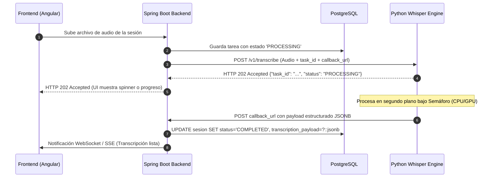

# 📄 Guía de Integración: Spring Boot & Python Transcription Engine

> **Fecha:** Octubre 2026  
> **Estado:** Aprobado / Listo para Implementación  
> **Componentes:** Backend Spring Boot (`brevemente-backend`) + Microservicio Python (`transcript_engine_python`) + PostgreSQL (`JSONB`)

---

## 1. 🎯 Resumen Ejecutivo y Arquitectura

El microservicio de Python actúa como un motor de cómputo puro y agnóstico de voz a texto utilizando **faster-whisper** con inferencia por lotes (`BatchedInferencePipeline`).  
El backend de **Spring Boot** es el orquestador del estado y la persistencia en PostgreSQL, guardando la transcripción completa en una columna de tipo `JSONB`.



---

## 2. 🗄️ Esquema en Base de Datos (PostgreSQL Flyway)

Migración SQL recomendada (ejemplo `V7__create_transcription_tasks.sql`):

```sql
CREATE TABLE transcription_tasks (
    id UUID PRIMARY KEY,
    session_id UUID NULL,
    status VARCHAR(30) NOT NULL DEFAULT 'PROCESSING',
    duration_seconds NUMERIC(10, 2) DEFAULT 0.0,
    language_detected VARCHAR(10),
    transcription_payload JSONB NULL,
    error_message TEXT NULL,
    created_at TIMESTAMP WITH TIME ZONE NOT NULL DEFAULT NOW(),
    updated_at TIMESTAMP WITH TIME ZONE NOT NULL DEFAULT NOW()
);

-- Índice Full-Text Search opcional sobre el texto completo para búsquedas instantáneas
CREATE INDEX idx_transcription_fulltext 
ON transcription_tasks USING gin (to_tsvector('spanish', COALESCE(transcription_payload->>'full_text', '')));
```

> **Nota de Rendimiento:** Gracias a **TOAST** en Postgres, `transcription_payload` se comprime automáticamente en un almacenamiento secundario fuera de línea. Las consultas normales de listado de sesiones no sufren ninguna degradación.

---

## 3. ☕ Modelos de Datos en Java (Spring Boot)

### A. DTOs de Recepción (Records)

```java
package com.syborx.brevemente.dto.transcription;

import java.util.List;
import java.util.UUID;

public record TranscriptionResultPayload(
    UUID task_id,
    String status,
    Double duration_seconds,
    String language_detected,
    String full_text,
    List<SegmentDto> segments,
    String error_message
) {}

public record SegmentDto(
    Integer id,
    String speaker, // "Terapeuta", "Paciente", "SPEAKER_00" o null
    Double start,
    Double end,
    String text,
    Double confidence
) {}

public record AsyncTranscriptionInitResponse(
    UUID task_id,
    String status
) {}
```

### B. Entidad JPA (Hibernate 6)

```java
package com.syborx.brevemente.domain;

import com.syborx.brevemente.dto.transcription.TranscriptionResultPayload;
import jakarta.persistence.*;
import org.hibernate.annotations.JdbcTypeCode;
import org.hibernate.type.SqlTypes;

import java.time.Instant;
import java.util.UUID;

@Entity
@Table(name = "transcription_tasks")
public class TranscriptionTask {

    @Id
    private UUID id;

    @Column(nullable = false)
    private String status; // PROCESSING, COMPLETED, FAILED

    @JdbcTypeCode(SqlTypes.JSON)
    @Column(name = "transcription_payload", columnDefinition = "jsonb")
    private TranscriptionResultPayload transcriptionPayload;

    private Double durationSeconds;
    private String languageDetected;
    private String errorMessage;

    private Instant createdAt;
    private Instant updatedAt;

    // Getters, Setters, Constructores...
}
```

---

## 4. 🌐 Controller de Callback Webhook en Spring Boot

```java
package com.syborx.brevemente.controller;

import com.syborx.brevemente.dto.transcription.TranscriptionResultPayload;
import com.syborx.brevemente.service.TranscriptionService;
import org.springframework.beans.factory.annotation.Value;
import org.springframework.http.HttpStatus;
import org.springframework.http.ResponseEntity;
import org.springframework.web.bind.annotation.*;

@RestController
@RequestMapping("/api/v1/internal/transcriptions")
public class TranscriptionWebhookController {

    @Value("${app.transcription.internal-api-key:dev-secret-api-key-change-in-prod}")
    private String expectedApiKey;

    private final TranscriptionService transcriptionService;

    public TranscriptionWebhookController(TranscriptionService transcriptionService) {
        this.transcriptionService = transcriptionService;
    }

    @PostMapping("/callback")
    public ResponseEntity<Void> handleTranscriptionCallback(
            @RequestHeader(value = "X-Internal-API-Key", required = false) String apiKey,
            @RequestBody TranscriptionResultPayload payload
    ) {
        if (apiKey == null || !apiKey.equals(expectedApiKey)) {
            return ResponseEntity.status(HttpStatus.FORBIDDEN).build();
        }

        transcriptionService.processCompletedTranscription(payload);
        return ResponseEntity.ok().build();
    }
}
```

---

## 5. 🚀 Invocación desde Spring Boot (`RestClient` / `WebClient`)

```java
package com.syborx.brevemente.service;

import com.syborx.brevemente.dto.transcription.AsyncTranscriptionInitResponse;
import org.springframework.beans.factory.annotation.Value;
import org.springframework.core.io.FileSystemResource;
import org.springframework.http.MediaType;
import org.springframework.stereotype.Service;
import org.springframework.util.LinkedMultiValueMap;
import org.springframework.util.MultiValueMap;
import org.springframework.web.client.RestClient;

import java.io.File;
import java.util.UUID;

@Service
public class TranscriptionClientService {

    @Value("${app.transcription.service-url:http://localhost:8000}")
    private String pythonEngineUrl;

    @Value("${app.transcription.internal-api-key:dev-secret-api-key-change-in-prod}")
    private String internalApiKey;

    @Value("${app.transcription.callback-url:http://localhost:8080/api/v1/internal/transcriptions/callback}")
    private String callbackUrl;

    private final RestClient restClient = RestClient.create();

    public AsyncTranscriptionInitResponse requestTranscription(UUID taskId, File audioFile) {
        MultiValueMap<String, Object> body = new LinkedMultiValueMap<>();
        body.add("file", new FileSystemResource(audioFile));
        body.add("task_id", taskId.toString());
        body.add("callback_url", callbackUrl);
        body.add("language", "es");

        return restClient.post()
                .uri(pythonEngineUrl + "/v1/transcribe")
                .header("X-Internal-API-Key", internalApiKey)
                .contentType(MediaType.MULTIPART_FORM_DATA)
                .body(body)
                .retrieve()
                .body(AsyncTranscriptionInitResponse.class);
    }
}
```
